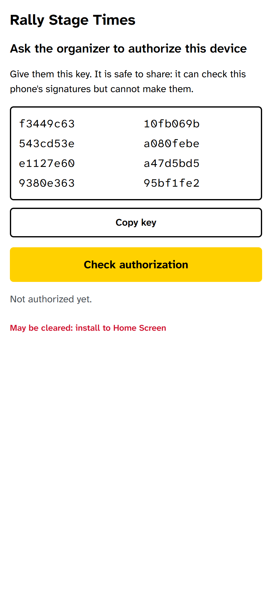
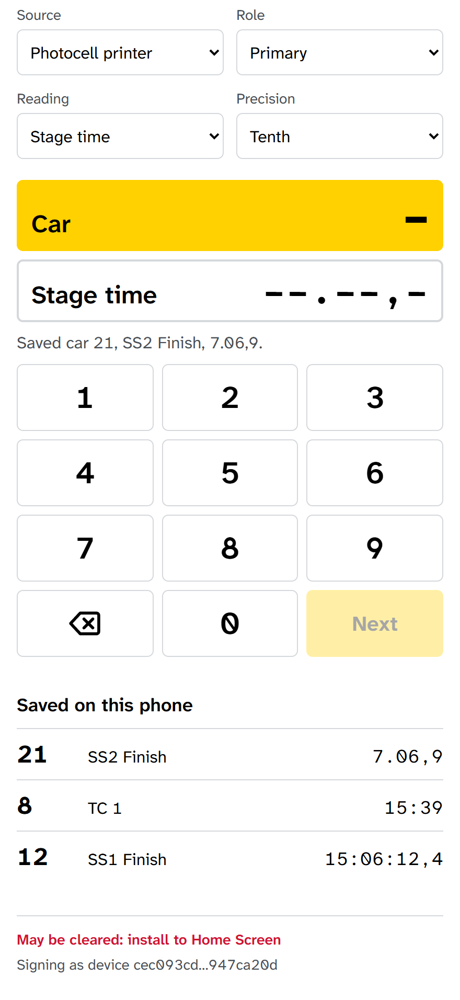
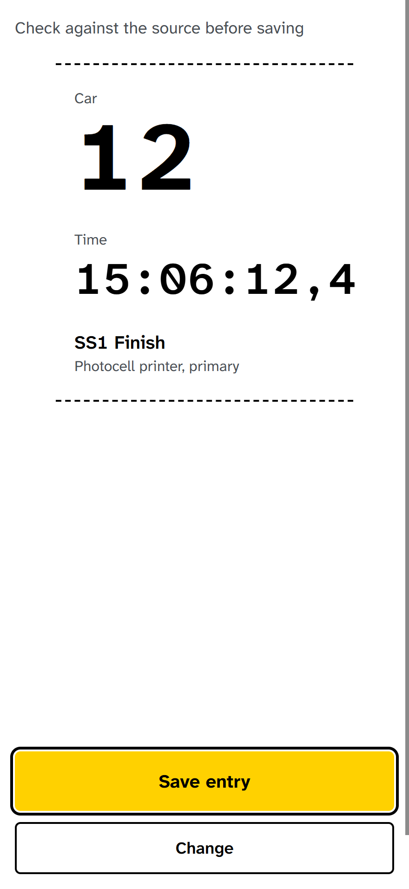

# Rally Timing Results

An offline-first web app for rally marshals. A marshal types in a car number
and the time shown by the event's timing equipment; the phone signs each entry
on the spot, so any later change is detectable, and sends the signed records to
a central database when there is a connection.

It is for rally clubs and organizers who already time their events with
photocells, clocks or stopwatches, and for the marshals at each stage and
time control who copy those readings. It replaces the paper time cards and
check sheets between the controls and the people who compute the results.

## Screenshots

<table>
  <tr>
    <td width="33%"></td>
    <td width="33%"></td>
    <td width="33%"></td>
  </tr>
  <tr>
    <td>Setup: the key the organizer authorizes</td>
    <td>Entry: the keypad and the last entries</td>
    <td>Readback: checked against the source before saving</td>
  </tr>
  <tr>
    <td></td>
    <td></td>
    <td></td>
  </tr>
  <tr>
    <td>No connection: entries wait on the phone</td>
    <td>Refused: the server names the reason</td>
    <td>Night stages: the dark scheme</td>
  </tr>
</table>

All data shown is generated dummy data.

## Architecture


Two rules hold throughout. An entry is signed and saved on the phone before
anything touches the network; syncing only moves records that already exist.
The server verifies each record (its format, its signature, what the device
is allowed to enter, and its place in the device's chain) and stores the
signed payload exactly as received, so it can be verified again at any time.
Only `npm run db:server` opens the database files; everything else connects
through `DATABASE_URL`.

## Built with

- [Next.js](https://nextjs.org) 16 with React 19, TypeScript 7 and Tailwind
  CSS 4, for the entry screen and the API.
- On the phone: [Dexie](https://dexie.org) over IndexedDB, WebCrypto Ed25519
  for signing, and [Serwist](https://serwist.pages.dev) for the offline
  service worker.
- On the server: [PGlite](https://pglite.dev) (Postgres in WebAssembly),
  [Drizzle ORM](https://orm.drizzle.team) with `pg`, and
  [zod](https://zod.dev).
- Tooling: npm on Node.js 22.13+, [Vitest](https://vitest.dev), and
  [Biome](https://biomejs.dev).

## Getting started

```sh
npm ci
cp .env.example .env.local   # DATABASE_URL points at the local database
npm run db:server            # in its own terminal; stop it with Ctrl+C
npm run db:migrate
npm run db:seed              # a dummy rally with generated data
npm run dev                  # http://localhost:3000
```

- `npm run build && npm start` serves the production build, with the offline
  service worker, on http://localhost:3100.
- `npm run device:authorize -- <public-key> SS3 FINISH` lets a device enter
  one point (`SS<n>` with `START`, `FINISH`, `SPLIT` or `STOP`, or `TC<code>`
  with `TC`). The public key is the one the device's setup screen shows.
- Checks: `npm run check` runs `npm run typecheck`, `npm run lint` and
  `npm test`.
- PGlite keeps its data in `.data/pglite`. To start over, stop `db:server`
  and run `npm run db:reset`, which deletes it (and refuses while
  `db:server` is running); then start `db:server`, migrate and seed again.

Phones reach the app over HTTPS (or `localhost`), since the browser offers
its signing API only in a secure context. Install it to the Home Screen
before setting the device up: on iOS the installed app has its own storage.

## API

Plain JSON over HTTP, never cached.

| Endpoint                   | Answers                                                                                                             |
| -------------------------- | ------------------------------------------------------------------------------------------------------------------- |
| `GET /api/health`          | `{"ok":true}` when the app can reach the database; 503 when it cannot                                               |
| `GET /api/rallies`         | Every rally, as `{ id, name }`                                                                                      |
| `GET /api/devices/<keyId>` | The device's rally, whether it is revoked, and its grants in itinerary order; 404 until it is authorized            |
| `POST /api/sync`           | Takes up to 500 signed records from one device and stores them in order up to the first one that fails verification |

## Data policy

This application strictly processes anonymized car numbers and timestamps. It
does not collect, process, or store personal user data, PII, or financial
records. All development relies on generated dummy data.

## Ownership

This is a 100% independent, personal side project. It is not related to,
sponsored by, or developed for any employer or client.

## License

Released under the MIT License. See [LICENSE](LICENSE).

## Not a timing system

This app does not measure time. Marshals manually enter times produced by the
event's existing timing equipment.
