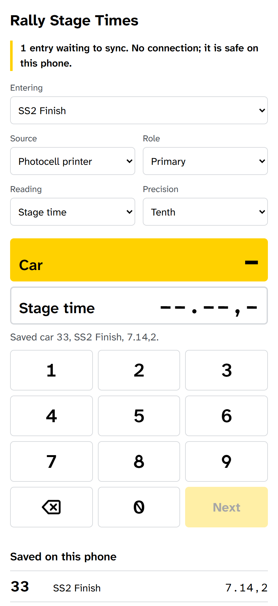
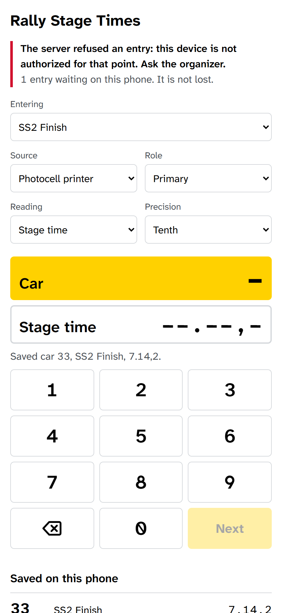
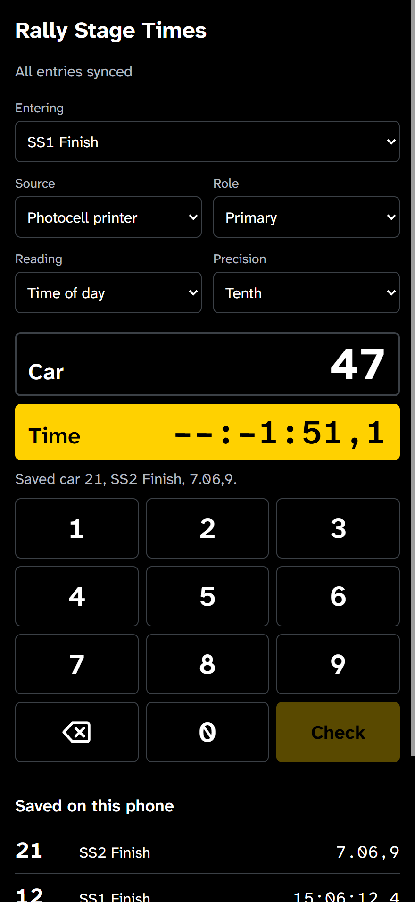
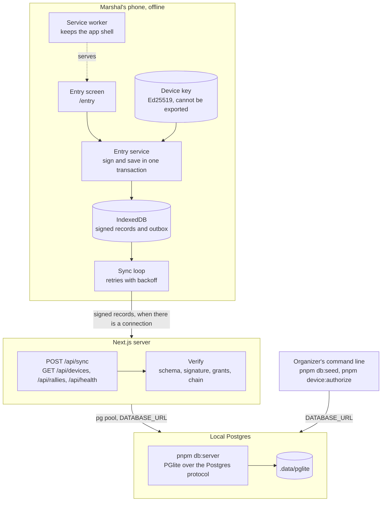

# Rally Stage Times

An offline-first web app for rally marshals. A marshal types in a car number
and the time shown by the event's timing equipment; the phone signs each entry
on the spot, so any later change is detectable, and sends the signed records to
a central database when there is a connection.

It is for rally clubs and organizers who already time their events with
photocells, clocks or stopwatches, and for the marshals at each stage and
time control who copy those readings. It replaces the paper time cards and
check sheets between the controls and the people who compute the results.

## Screenshots

<table>
  <tr>
    <td width="33%"></td>
    <td width="33%"></td>
    <td width="33%"></td>
  </tr>
  <tr>
    <td>Setup: the key the organizer authorizes</td>
    <td>Entry: the keypad and the last entries</td>
    <td>Readback: checked against the source before saving</td>
  </tr>
  <tr>
    <td></td>
    <td></td>
    <td></td>
  </tr>
  <tr>
    <td>No connection: entries wait on the phone</td>
    <td>Refused: the server names the reason</td>
    <td>Night stages: the dark scheme</td>
  </tr>
</table>

All data shown is generated dummy data.

## Architecture



Two rules hold throughout. An entry is signed and saved on the phone before
anything touches the network; syncing only moves records that already exist.
The server verifies each record (its format, its signature, what the device
is allowed to enter, and its place in the device's chain) and stores the
signed payload exactly as received, so it can be verified again at any time.
Only `pnpm db:server` opens the database files; everything else connects
through `DATABASE_URL`. The reasons behind these choices are in
[docs/adr/](docs/adr/).

## Built with

- [Next.js](https://nextjs.org) 16 (App Router, Turbopack) with React 19,
  TypeScript 7 and Tailwind CSS 4, for the entry screen and the API.
- On the phone: [Dexie](https://dexie.org) over IndexedDB for the records
  and the outbox, WebCrypto Ed25519 for signing, and
  [Serwist](https://serwist.pages.dev) for the offline service worker.
- On the server: [PGlite](https://pglite.dev) (Postgres in WebAssembly) behind
  a small socket server, [Drizzle ORM](https://orm.drizzle.team) with `pg`,
  and [zod](https://zod.dev) to check every request and record.
- Tooling: pnpm 12 on Node.js 26, [Vitest](https://vitest.dev) with
  fast-check and fake-indexeddb, and [Biome](https://biomejs.dev) for lint and
  format.

## Setup

Requires [pnpm](https://pnpm.io) 12 (the version in `packageManager`). pnpm
downloads and uses the Node.js version declared in `package.json`
(`devEngines.runtime`) for the project's scripts.

```sh
pnpm install
pnpm dev                # http://localhost:3000, with db:server running
pnpm build && pnpm start   # production build, on http://localhost:3100
```

The app needs the local database: see [Database](#database).

Checks, all of which must pass before a change is done:

```sh
pnpm typecheck          # next typegen, then tsc --noEmit (TypeScript 7)
pnpm lint               # Biome; auto-fix with pnpm lint --write
pnpm test               # Vitest; one file: pnpm test path/to/file.test.ts
```

## Database

Postgres runs locally as [PGlite](https://pglite.dev), with no Docker or
installed server. Its data lives in `.data/pglite` (git-ignored).

```sh
cp .env.example .env.local   # once; DATABASE_URL points at the local server
pnpm db:server               # in its own terminal; stop it with Ctrl+C
pnpm db:migrate              # applies the migrations in drizzle/
```

- `pnpm db:server` is the only process that opens `.data/pglite`. It listens
  on `127.0.0.1` at the port in `DATABASE_URL`, and the app, the scripts and
  drizzle-kit all connect through that URL. A second copy finds the port in
  use and exits without opening the data.
- Stop it with Ctrl+C so it closes the database cleanly.
- After changing `src/lib/server/db/schema.ts`, run
  `pnpm db:generate --name <change>`, then `pnpm db:migrate`. The files in
  `drizzle/` are generated; do not edit them.
- To start over, stop `db:server` and delete `.data/`.
- Moving to a hosted or installed Postgres only changes `DATABASE_URL`.

## Seed and device authorization

There is no admin interface yet: rallies and devices are set up from the
command line, with `db:server` running.

```sh
pnpm db:seed
pnpm device:authorize <public-key> SS3 FINISH
pnpm device:authorize <public-key> TC4A TC
```

- `pnpm db:seed` creates a dummy rally with generated data only. Its
  structure follows a typical regional event: one leg over two days, four
  sections, a non-scoring shakedown (`SS0`), seven special stages ending in a
  Power Stage, coded time controls with allotted times, a flexi service with
  a maximum, and 70 car numbers in 10 classes. Running it again does nothing.
- `pnpm device:authorize` registers a device's raw Ed25519 public key
  (the 64 hex characters its setup screen shows) and grants it one point: `SS<n>` with
  `START`, `FINISH`, `SPLIT` or `STOP`, or `TC<code>` with `TC`. Run it again
  for each further point; one device can hold several, for example a regroup
  control and the `FINISH` of the stage before it. With more than one rally,
  add `--rally <id>`.
- A device key belongs to one rally. A device needs a new key, and a new
  authorization, for the next rally.

## Installing to the Home Screen

Install the app on each phone before setting it up, then open it from the
Home Screen and set it up there:

- iPhone and iPad (Safari): Share, then Add to Home Screen. The Home Screen
  app keeps its own storage, separate from Safari's, so a key created in a
  Safari tab would not exist in the installed app. Safari can also clear a
  tab's storage after 7 days without a visit; Home Screen apps keep theirs.
- Android (Chrome): the menu's Install app, or Add to Home screen.

Then, on the phone:

1. Open the app. With one rally on the server it is chosen automatically;
   otherwise choose it.
2. Tap Set up this device. This asks the browser to keep the app's storage
   and creates the device's key. The screen shows "Storage: persistent" when
   the browser agreed, or "May be cleared: install to Home Screen".
3. Give the key shown to the organizer, who runs `pnpm device:authorize` for
   each point the phone will enter, then tap Check authorization.

Each entry is signed and saved on the phone first, and sent to the server
whenever there is a connection: at once after saving, when the connection
comes back, when the app is reopened, and every 30 seconds. The line at the
top of the screen shows how many entries are waiting. A failed request
counts as no connection, whatever the phone's network icon shows, and
retries back off (2 seconds, doubling up to 5 minutes) so many phones
regaining signal at once do not retry in step.

Phones must reach the app over HTTPS (or `localhost`): the browser offers its
signing API only in a secure context.

## Testing offline

The service worker exists only in the production build, so test offline
behavior there, never with `pnpm dev`:

```sh
pnpm db:server               # in its own terminal
pnpm build && pnpm start     # http://localhost:3100
```

1. Open http://localhost:3100/entry, set up the device and enter a time. The
   service worker is now installed and holds the entry screen.
2. Stop `pnpm start` (leave `db:server` running) and reload the page. It
   still opens, and entries are signed and saved; the top line counts them
   as waiting. Any page the worker does not hold shows "No connection".
3. Start `pnpm start` again. Within a few seconds the waiting entries reach
   the server and the line reads "All entries synced".

`pnpm start` uses port 3100 so the production worker never takes control of
the dev server's origin (port 3000). The worker never caches `/api/`, so a
stopped server shows as unreachable instead of answering from a cache. A new
build takes over only once every tab of the app is closed, never in the
middle of an entry.

## API

Plain JSON over HTTP, never cached. Response bodies are defined by the zod
schemas in `src/lib/api/contract.ts`.

| Endpoint                   | Answers                                                                                                             |
| -------------------------- | ------------------------------------------------------------------------------------------------------------------- |
| `GET /api/health`          | `{"ok":true}` when the app can reach the database; 503 when it cannot                                               |
| `GET /api/rallies`         | Every rally, as `{ id, name }`                                                                                      |
| `GET /api/devices/<keyId>` | The device's rally, whether it is revoked, and its grants in itinerary order; 404 until it is authorized            |
| `POST /api/sync`           | Takes up to 500 signed records from one device and stores them in order up to the first one that fails verification |

## Documentation

- [ROADMAP.md](ROADMAP.md): planned work and how to start on it.
- [AGENTS.md](AGENTS.md): instructions for coding agents: commands, layout,
  and the integrity rules every change must keep.
- [docs/domain.md](docs/domain.md): rally terms, the regulations the app
  relies on, and the reference event.
- [docs/landscape.md](docs/landscape.md): existing tools and practices, and
  where this app fits.
- [docs/adr/](docs/adr/): design decisions and why they were made.

## Data policy

This application strictly processes anonymized car numbers and timestamps. It
does not collect, process, or store personal user data, PII, or financial
records. All development relies on generated dummy data.

## Ownership

This is a 100% independent, personal side project. It is not related to,
sponsored by, or developed for any employer or client.

## License

Released under the MIT License. See [LICENSE](LICENSE).

## Not a timing system

This app does not measure time. Marshals manually enter times produced by the
event's existing timing equipment.
